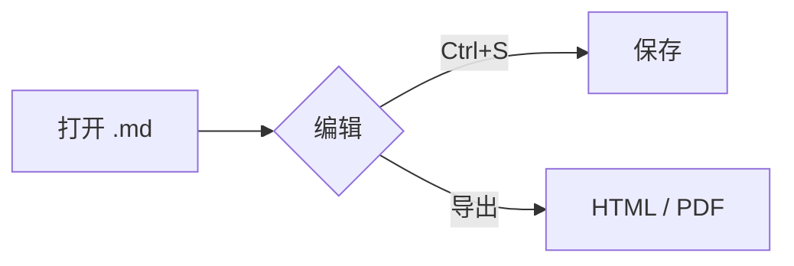

# Inkmark 示例文档

欢迎使用 **Inkmark** —— 一个本地 Markdown 编辑器。把光标移到任意元素上即可看到它的 Markdown 源码；按 `Ctrl+/` 切换到源代码模式。

[TOC]

## 文本样式

**加粗**、*斜体*、<u>下划线</u>、~~删除线~~、`行内代码`、==高亮==，以及一个[链接](https://github.com/yataome1/inkmark)（按住 Ctrl 单击打开）。

> 引用块：写作的关键是减少干扰。
>
> —— 按 `F8` 试试专注模式，`F9` 试试打字机模式。

## 列表

- 无序列表
  - 嵌套项
- 第二项

1. 有序列表
2. 第二项

- [x] 已完成的任务
- [ ] 待办任务

## 表格

| 功能 | 快捷键 | 说明 |
| :--- | :---: | ---: |
| 保存 | `Ctrl+S` | 原子写入 |
| 侧边栏 | `Ctrl+Shift+L` | 大纲 / 文件树 |
| 源代码模式 | `Ctrl+/` | 纯文本编辑 |

点进单元格可使用工具条；右键单元格增删行列，悬停时拖动手柄移动行列。

## 代码

```javascript
function greet(name) {
  return `Hello, ${name}!`;
}
console.log(greet('Inkmark'));
```

## 数学公式

行内公式：$E = mc^2$

$$
\int_{-\infty}^{\infty} e^{-x^2}\,dx = \sqrt{\pi}
$$

## 图表



## 图片

相对路径图片（相对于本文档所在目录）：


## 脚注

Inkmark 使用 CodeMirror 作为编辑内核[^1]。

[^1]: https://codemirror.net/

---

*粘贴图片会自动保存到文档旁的 `assets/` 目录。*
